# 🛡️ Payment Sentinel: Agentic Ödeme Patern ve Anomali Analizi

Payment Sentinel, ödeme sistemi loglarındaki paternleri analiz eden, normal davranıştan sapmaları tespit eden, etkisini ölçen ve **kanıta dayalı inceleme raporu** üreten bir AI agent uygulamasıdır. Agentic AI Bootcamp kapanış projesi olarak geliştirilmiştir.

> Varsayılan demo tamamen **sentetik veriyle** ve yerel olarak çalışır. Gerçek müşteri, kart veya kişisel veri kullanılmaz; hiçbir üretim sistemine bağlanılmaz ve ödeme işlemi yapılmaz.

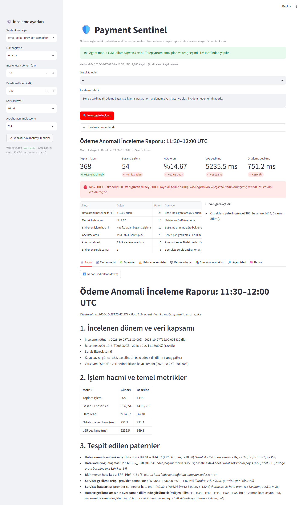

---

## İçindekiler
1. [Problem ve gerçek dünyadaki kullanım](#1-problem-ve-gerçek-dünyadaki-kullanım)
2. [Neden tek bir LLM çağrısı yetmez?](#2-neden-tek-bir-llm-çağrısı-yetmez)
3. [Agentic mimari](#3-agentic-mimari)
4. [Araçlar ve iş akışı](#4-araçlar-ve-iş-akışı)
5. [Patern ve anomali tespiti](#5-patern-ve-anomali-tespiti)
6. [Geçmiş incident karşılaştırması](#6-geçmiş-incident-karşılaştırması)
7. [RAG: runbook araması](#7-rag-runbook-araması)
8. [Risk skoru ve güven düzeyi](#8-risk-skoru-ve-güven-düzeyi)
9. [Doğrulama ve hata yönetimi](#9-doğrulama-ve-hata-yönetimi)
10. [Büyük veri ve Elasticsearch](#10-büyük-veri-ve-elasticsearch)
11. [Teknolojiler ve seçim gerekçeleri](#11-teknolojiler-ve-seçim-gerekçeleri)
12. [Kurulum ve çalıştırma](#12-kurulum-ve-çalıştırma)
13. [Demo senaryoları](#13-demo-senaryoları)
14. [Testler ve benchmark](#14-testler-ve-benchmark)
15. [Güvenlik](#15-güvenlik)
16. [Sınırlamalar](#16-sınırlamalar)
17. [Ekran görüntüleri](#17-ekran-görüntüleri)
18. [Proje yapısı](#18-proje-yapısı)

---

## 1. Problem ve gerçek dünyadaki kullanım

Ödeme platformlarında bir sağlayıcı yavaşladığında, bir gateway timeout vermeye başladığında ya da trafik sessizce düştüğünde, on-call mühendisi dakikalar içinde şu sorulara cevap vermek zorundadır:

- Hata oranında gerçekten belirgin bir artış var mı, yoksa normal dalgalanma mı?
- Hangi servisler ve hata kodları öne çıkıyor? Sorun ne zaman başladı, hâlâ sürüyor mu?
- Gecikme artışı hata artışıyla aynı zaman diliminde mi görülüyor?
- Kaç işlem etkilendi? Geçmişte benzer bir olay yaşandı mı, nasıl çözüldü?
- Runbook'lar hangi inceleme adımlarını öneriyor?
- Kanıtlar neyi destekliyor, hangi bilgiler eksik?

Bu süreç bugün genellikle dashboard'lar, log sorguları, wiki sayfaları ve geçmiş incident kayıtları arasında elle yürütülür. Payment Sentinel bu **triage sürecini** otomatikleştirir. Talebi yorumlar, gerekli sorguları kendisi seçip çalıştırır, sonuçları birlikte değerlendirir ve on-call ekibine kaynaklı, doğrulanmış bir ilk inceleme raporu sunar. Kök nedeni **iddia etmez**; gözlemi, hipotezi ve doğrulanmış nedeni ayrı tutar.

## 2. Neden tek bir LLM çağrısı yetmez?

| İhtiyaç | Tek LLM çağrısı | Payment Sentinel |
|---|---|---|
| Binlerce/milyonlarca log | Bağlama sığmaz, maliyetli | Veri kaynağında toplulaştırma; LLM yalnızca özet görür |
| Doğru sayılar | LLM hesapta hata yapar, sayı uydurabilir | Tüm metrikler Python'da deterministik hesaplanır |
| Sorgunun sonuca göre değişmesi | Tek atış, geri bildirim yok | Gözlemle → karar ver döngüsü (patern varsa log, incident ve runbook aranır) |
| Eksik veri / araç hatası | Fark edilmez | Verifier eksik kanıtı tespit eder, sınırlı ek sorgu yapar veya kısıtı raporlar |
| Kurum bilgisi (runbook, geçmiş olaylar) | Modelde yok | RAG ve incident eşleştirme araçları |
| Halüsinasyon | Kontrol yok | Rapordaki sayılar araç çıktılarıyla karşılaştırılır, kanıtsız iddialar reddedilir |

Bu problem birden çok kaynaktan veri toplamayı, ara sonuçlara göre karar vermeyi ve doğrulamayı gerektirir. Bu yüzden agentic bir akışa ihtiyaç duyar.

## 3. Agentic mimari

Orkestrasyon **LangGraph** ile yapılır (eğitimde öğrenilen `StateGraph` + koşullu kenarlar + checkpointer kalıbı).

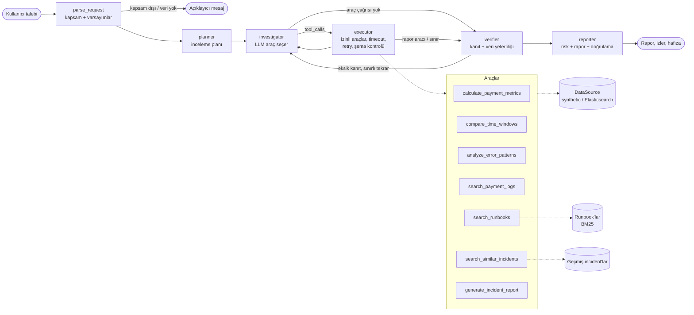

| Agentic yetenek | Uygulama |
|---|---|
| **Planlama** | `planner` düğümü LLM ile kısa bir inceleme planı yazar (LLM yoksa deterministik plan) |
| **Araç kullanımı** | LLM `bind_tools` ile 7 gerçek Python aracı arasından seçim yapar; `executor` yalnızca izin listesindeki araçları çalıştırır |
| **Çok adımlı akıl yürütme** | Investigator ⇄ executor döngüsü: her araç sonucu bir sonraki kararı belirler |
| **Hafıza** | LangGraph `InMemorySaver` checkpointer + Streamlit oturum `thread_id`. "Şimdi sadece acquirer-gateway'e bak" gibi takip soruları önceki kapsamı kullanır |
| **Öz-denetim** | `verifier` düğümü zorunlu kanıtları ve veri yeterliliğini kontrol eder, gerekirse baseline'ı genişletir veya eksik aracı yeniden çağırtır |
| **Sınırlar** | `MAX_TOOL_CALLS=12`, `MAX_RETRIES=2`, araç başına 1 geçici hata tekrarı, araç timeout'u 10 sn, LangGraph `recursion_limit=40` |
| **Graceful degradation** | LLM erişilemezse ya da adım ortasında hata verirse aynı araçlar deterministik planla çalışmaya devam eder; arayüz bunu açıkça gösterir |

**Neden tek agent + verifier?** Problem tek bir uzmanlık alanında (ödeme operasyonu) ve araçlar aynı veri kaynağını kullanıyor. Çoklu agent koordinasyonu burada ek gecikme ve hata yüzeyi getirirdi. Bunun yerine doğrulama, LLM'den bağımsız deterministik bir *verifier* düğümüne verildi. Bu, küçük bir yerel modelle bile güvenilir sonuç almayı sağlıyor.

**LLM'in görevi:**
- Serbest metin talebi yorumlamak (zaman aralığı, servis, hata kodu, takip sorusu mu, kapsam içi mi).
- Plan yazmak.
- Hangi aracın hangi sırayla çağrılacağına karar vermek.
- Runbook sorgusunu oluşturmak.
- Bulgu özeti yazmak.

**LLM'in görevi olmayanlar:**
- Sayısal hesap yapmak.
- Risk puanı vermek.
- Kök neden ilan etmek.

## 4. Araçlar ve iş akışı

| Araç | Görev |
|---|---|
| `calculate_payment_metrics(start, end, service)` | Toplam/başarılı/başarısız işlem, hata oranı, ortalama ve p95 gecikme |
| `compare_time_windows(current, baseline, service)` | Hata oranı farkı (puan) ve oranı, p95/ortalama gecikme değişimi, dakika başı hacim değişimi, baseline'a göre fazladan başarısız işlem |
| `analyze_error_patterns(current, baseline, service)` | 7 patern tipi, servis karşılaştırma tablosu, 5 dk dilimler, başlangıç zamanı, süre, ani/kademeli başlangıç |
| `search_payment_logs(start, end, service, error_code, status, limit, cursor)` | Sayfalı ve en fazla 50 kayıtla sınırlı örnek log getirir |
| `search_similar_incidents(current, baseline, service)` | Anomali imzasını **veriden yeniden hesaplar** (LLM'in verdiği sayılara güvenmez) ve geçmiş olaylarla karşılaştırır |
| `search_runbooks(query)` | Runbook'larda kaynaklı BM25 araması; ilgili "İnceleme Adımları" bölümünü döner |
| `generate_incident_report(findings)` | LLM'in bulgu özetini alır; bulgular doğrulamadan geçerse rapora eklenir |

**Tipik akış:**
1. Talep yorumlanır. Örneğin "son 30 dakika" ifadesinde "şimdi" veri setindeki son kayıt zamanı olarak alınır ve bu varsayım raporda yazılır.
2. Plan oluşturulur.
3. Metrikler hesaplanır ve baseline ile karşılaştırılır.
4. Paternler analiz edilir.
5. Şüpheli patern varsa başarısız log örnekleri, benzer incident'lar ve runbook'lar aranır.
6. Verifier kanıtları kontrol eder.
7. Risk değerlendirmesi ve rapor oluşturulur.

## 5. Patern ve anomali tespiti

Makine öğrenmesi kullanılmaz. Her patern; hangi metriğe, hangi kurala ve eşiğe göre tespit edildiğini ve kaç örneğe dayandığını birlikte döner (`src/patterns.py`).

| Patern | Kural (demo eşikleri) |
|---|---|
| `ERROR_RATE_SPIKE` | Δ ≥ 2 puan, oran ≥ 2x, **iki oran z-testi** z ≥ 3, başarısız ≥ 5, her iki pencerede n ≥ 30 |
| `VOLUME_ANOMALY` | Dakika başı hacim değişimi ≤ −30% veya ≥ +50% **ve** baseline dilimlerine göre \|z\| ≥ 3 |
| `ERROR_CODE_CONCENTRATION` | Tek kodun başarısızlar içindeki payı ≥ %50, adet ≥ 10, trafiğe oranı baseline'ın ≥ 3x'i |
| `UNKNOWN_ERROR_CODE` | Hata kodu kataloğunda olmayan kod |
| `SERVICE_LATENCY_INCREASE` | Servis p95'i **kendi baseline'ına göre** ≥ %50 arttı (n ≥ 20) |
| `SERVICE_ERROR_SPIKE` | Servis hata oranı Δ ≥ 3 puan, z ≥ 3 |
| `ERROR_LATENCY_COOCCURRENCE` | Hata ve p95 anomalisi aynı 5 dk dilimde ≥ 2 kez (bir **korelasyon** olarak raporlanır) |

- **Yanlış alarm önlemi:** Minimum örneklem kontrolleri ve z-testi kullanılır. Normal trafikte kayan 30 dk pencerelerin hiçbirinde alarm üretilmediği test edilir.
- **Sıfır payda:** `safe_rate` ve `pct_change` fonksiyonları `None` döner, sıfıra bölme hatası oluşmaz.
- **Veri aralığı:** Pencere veri aralığının dışına taşarsa, kapsanmayan dakikalar hacim hesabına girmez.

## 6. Geçmiş incident karşılaştırması

`data/incidents.json` içinde 8 sentetik geçmiş olay vardır. Her kayıtta şunlar bulunur:
- Servis ve hata kodları
- Patern tipleri ve başlangıç şekli
- Hata oranı, gecikme ve hacim değişimi
- Neden ve nedenin doğrulanma durumu (`verified` / `unverified`)
- Çözüm ve sonuç

Benzerlik ağırlıklıdır ve tek bir hata koduna dayanmaz:

| Sinyal | Ağırlık |
|---|---|
| Patern tipleri (Jaccard) | 0.25 |
| Servis | 0.20 |
| Hata kodları (Jaccard) | 0.20 |
| Başlangıç şekli (ani/kademeli) | 0.10 |
| Hata oranı farkı yakınlığı (log ölçek) | 0.10 |
| Gecikme değişimi yakınlığı | 0.10 |
| Hacim değişimi yakınlığı | 0.05 |

Eşik 0.45'tir. Rapor ve arayüz her eşleşmede şu uyarıyı gösterir: *"Geçmiş bir olayla benzerlik, aynı kök nedenin mevcut olduğunu kanıtlamaz."*

## 7. RAG: runbook araması

- `data/runbooks/` altında 6 operasyon dokümanı vardır: gateway timeout, sağlayıcı bağlantı hataları, HTTP 5xx, latency, bilinmeyen kodlar, hacim düşüşü.
- Dokümanlar Markdown başlıklarına göre bölümlere ayrılır (eğitimdeki başlık tabanlı chunk'lama fikri). Her parça **kaynak dosya + bölüm** bilgisini taşır.
- Arama **BM25** (`rank-bm25`) ile yapılır. Skor eşiğin altındaysa "ilgili runbook bulunamadı" denir ve öneriler yalnızca gözlemlere dayanır.
- Öneriler yalnızca bulunan runbook'un **"İnceleme Adımları"** bölümünden, kaynağıyla birlikte alınır.
- **Neden FAISS/embedding değil?** Runbook'lar hata kodu ve servis adları gibi tam eşleşmesi önemli terimler içeriyor. BM25 bu durumda iyi çalışıyor, model indirme gerektirmiyor ve sonuçları deterministik (test edilebilir). Eğitimdeki FAISS + Qwen embedding yaklaşımı daha büyük ve serbest metinli doküman setinde tercih edilirdi.
- Doküman içeriği **güvenilmeyen veri** kabul edilir. "Ignore previous instructions…" gibi talimat satırları ayıklanır ve işaretlenir. Test için `unknown_error_codes.md` dosyasına bilerek böyle bir satır konmuştur.

## 8. Risk skoru ve güven düzeyi

`src/risk_engine.py` iki **ayrı** değer üretir:

**Risk skoru (0–100), operasyonel etki:**

| Sinyal | Puan |
|---|---|
| Hata oranı baseline farkı | ≥5 puan: +25 · ≥2 puan: +12 |
| Mutlak hata oranı ≥ %10 | +10 |
| Etkilenen işlem (fazladan başarısız) | ≥100: +20 · ≥25: +10 |
| İşlem hacmi düşüşü | ≥%50: +30 · ≥%30: +20 |
| Servis p95 gecikme artışı | ≥%200: +20 · ≥%50: +10 |
| Anomali süresi | ≥20 dk: +10 · ≥10 dk: +5 |
| Etkilenen servis sayısı | ≥2: +10 · 1: +5 |

Seviyeler: `LOW` < 30 ≤ `MEDIUM` < 60 ≤ `HIGH`. Her puanın gerekçesi arayüzde ve raporda gösterilir. **Ağırlıklar demo amaçlıdır, üretim için kalibre edilmemiştir.**

**Veri güven düzeyi (`HIGH`/`MEDIUM`/`LOW`), bulguların dayandığı verinin yeterliliği:**
- Örneklem büyüklüğüne ve zaman dilimi sayısına göre belirlenir.
- Araç hatası, eksik kanıt veya değerlendirilemeyen patern varsa düşürülür.
- Risk puanı ile istatistiksel güven karıştırılmaz. Örneğin runbook aracı çöktüğünde risk HIGH kalır, güven LOW olur.

Pencerelerden biri 30 işlemin altındaysa güvenilir bir sınıf üretilmez; sonuç **`INDETERMINATE`** olur.

## 9. Doğrulama ve hata yönetimi

| Durum | Davranış |
|---|---|
| Geçersiz/ters/24 saati aşan zaman aralığı, bilinmeyen servis | `InputValidationError`; LLM'e düzeltme ipucuyla geri döner |
| Bilinmeyen hata kodu | Uyarı ile incelenir; ayrıca bir patern olarak raporlanır |
| Boş pencere / boş veri kaynağı | Güvenli `None` değerleri; risk `INDETERMINATE` |
| Belirsiz talep ("bir sorun var gibi") | Varsayılan 30 dk + 120 dk baseline; varsayım raporda yazılır |
| Kapsam dışı talep ("şiir yaz") | İnceleme yapılmaz, örnek bir talep önerilir |
| LLM'in uydurduğu kapsam (talepte geçmeyen servis/kod) | Yok sayılır ve izlerde gösterilir |
| Geçici araç hatası / timeout | Araç başına 1 tekrar |
| Kalıcı araç hatası | Tekrar denenmez; rapor kısıtlamalarına yazılır, güven düşer |
| LLM zorunlu araçları atlarsa | Verifier önce hatırlatır, sonra eksik kanıtı deterministik olarak tamamlar |
| Baseline örneklemi yetersiz | Veri izin veriyorsa baseline bir kez genişletilir |
| Sonsuz döngü | 12 araç çağrısı sınırı ve recursion limit |
| Araç çıktısı şemaya uymuyor | Pydantic doğrulaması; hata olarak işlenir |
| Rapordaki sayılar | Araç çıktılarıyla birebir karşılaştırılır |
| LLM bulgularında araç çıktısında olmayan sayı veya "kök neden doğrulandı" gibi iddia | Bulgu reddedilir ve doğrulama bölümünde gösterilir |
| Kanıtsız öneri/açıklama | Her öneri bir runbook/incident kaynağına, her açıklama bir gözlem kimliğine (O1, O2…) bağlıdır |

Rapor bölümleri:
1. Dönem ve veri kapsamı
2. Metrikler
3. Tespit edilen paternler
4. Sapmalar
5. Etkilenen servisler ve hata kodları
6. Benzer incident'lar
7. Risk ve gerekçesi
8. **Gözlemler (ölçülmüş)**
9. **Olası açıklamalar (hipotez)**
10. **Doğrulanmış kök neden (her zaman "yok")**
11. Runbook kaynakları
12. Önerilen inceleme adımları
13. Veri eksikleri ve sınırlamalar
14. Doğrulama durumu

## 10. Büyük veri ve Elasticsearch

- Araçlar yalnızca `DataSource` arayüzünü kullanır (`src/datasource/base.py`). Arayüzün metotları: `summary`, `histogram`, `group_by`, `top_terms`, `sample`.
- Arayüz şu durumları otomatik olarak reddeder:
  - 24 saati aşan pencere
  - 500'den fazla zaman dilimi
  - 50'den fazla örnek kayıt
  - İzinli olmayan alanlar
- `SyntheticDataSource` (varsayılan) zaman sıralı veride pencereyi ikili aramayla (`searchsorted`) keser.
- `ElasticsearchDataSource` aynı sözleşmeyi uygular. Filtreleme ve toplulaştırma sunucuda yapılır (`range`/`term` filtreleri, `date_histogram`, `terms`, `percentiles`), sayfalama `from`/`size` iledir. Python'a yalnızca agregasyon sonuçları gelir.
- **LLM'e asla ham log kümesi gönderilmez.** LLM yalnızca kısaltılmış araç özetlerini görür (en fazla 2500 karakter).

> ⚠️ Elasticsearch adaptörü **canlı bir kümede doğrulanmamıştır**. Query DSL ve yanıt ayrıştırma birim testlerle (sahte istemci) kontrol edilir. Kullanmak için `pip install -r requirements-es.txt` ve `.env` içinde `DATA_SOURCE=elasticsearch`, `ES_URL`, `ES_INDEX` gerekir. Beklenen mapping: `timestamp` (date), `service`/`status`/`error_code`/`payment_method` (keyword), `latency_ms` (numeric).

## 11. Teknolojiler ve seçim gerekçeleri

| Teknoloji | Neden |
|---|---|
| **Python 3.14** | Eğitim ortamıyla aynı; 3.12+ ile çalışması beklenir |
| **LangGraph** | Eğitimde öğrenildi; koşullu döngüler, adım limiti ve checkpointer (hafıza) hazır |
| **LangChain Core** | `bind_tools` ile tool calling ve sağlayıcıdan bağımsız mesaj modeli |
| **Ollama + qwen3.5:4b** (varsayılan) | Yerel ve ücretsiz, API anahtarı gerekmez; eğitimde kullanılan model |
| **Gemini** (opsiyonel) | Daha güçlü tool calling için `.env` ile seçilebilir |
| **pandas / numpy** | Deterministik metrik ve agregasyon hesapları |
| **Pydantic v2** | Araç argümanı ve çıktı şemaları, rapor modeli |
| **rank-bm25** | Kurulumu kolay, deterministik ve kaynaklı runbook araması |
| **Streamlit** | Hızlı, okunaklı arayüz; canlı ilerleme (`st.status`) ve grafikler |
| **pytest** | 65 otomatik test; LLM sahte nesneyle simüle edilir |
| **Playwright** (yalnızca geliştirme) | Ekran görüntülerini çalışan uygulamadan otomatik almak için |

## 12. Kurulum ve çalıştırma

**Gereksinimler:** Python 3.12+ (3.14.7 ile test edildi). LLM modu için opsiyonel olarak [Ollama](https://ollama.com) gerekir.

```bash
git clone <repo-url> payment-sentinel
cd payment-sentinel

python -m venv .venv
# Windows:
.venv\Scripts\activate
# macOS/Linux:
source .venv/bin/activate

pip install -r requirements.txt

# Ortam değişkenleri
copy .env.example .env        # Windows
cp .env.example .env          # macOS/Linux

# Sentetik veri (repoda hazır gelir; yeniden üretmek için, sonuç aynıdır)
python -m src.data_generator

# Uygulama
streamlit run app.py
```

Tarayıcıda `http://localhost:8501` açılır, bir senaryo seçip **Investigate Incident** butonuna basılır.

> `python app.py` (ör. VS Code'daki **Run Python File** butonu) da çalışır; uygulama kendini otomatik olarak `streamlit run` ile yeniden başlatır. VS Code'da `.venv` yorumlayıcısının seçili olduğundan emin olun (**Python: Select Interpreter**).

**LLM modu (opsiyonel):**
```bash
ollama pull qwen3.5:4b          # .env: LLM_PROVIDER=ollama
# veya .env içinde: LLM_PROVIDER=gemini ve GEMINI_API_KEY=...
```

LLM erişilemezse uygulama otomatik olarak **sınırlı deterministik demo moduna** geçer ve bunu ekranda belirtir. API anahtarı olmadan da bütün senaryolar çalışır. LLM sağlayıcısı kenar çubuğundan da değiştirilebilir (`none` = deterministik).

## 13. Demo senaryoları

| Senaryo | İçerik | Beklenen sonuç |
|---|---|---|
| `normal` | Normal trafik (~%2 hata) | Patern yok, **LOW**, yanlış alarm yok |
| `error_spike` | 11:35'ten sonra provider-connector'da PROVIDER_TIMEOUT artışı + bilinmeyen kod ERR_PRV_7781 | **HIGH (80)**; benzer olay INC-2026-0412 |
| `latency_degradation` | 11:25'ten sonra acquirer-gateway p95 artışı + GATEWAY_504 | **MEDIUM (47)**; hata-gecikme örtüşmesi; benzer olay INC-2026-0603 |
| `volume_drop` | 11:40'tan sonra hacimde düşüş, hata oranı normal | **MEDIUM (30)**; benzer olay INC-2026-0805 |

**Önerilen 3 dakikalık demo akışı:**
1. `error_spike` + `ollama` seçilir ve örnek talep çalıştırılır. Canlı ilerlemede LLM'in araç seçimleri izlenir.
2. **Agent izleri** sekmesinde şunlar gösterilir: plan, araç çağrıları, LLM'in uydurduğu kapsamın yok sayılması, verifier.
3. **Rapor** sekmesinde gözlem, hipotez ve doğrulanmış kök neden ayrımı gösterilir.
4. Aynı oturumda "Şimdi sadece acquirer-gateway servisine bak" yazılır. **Hafıza** sekmesi önceki kapsamın kullanıldığını gösterir.
5. Kenar çubuğundan `search_runbooks: kalıcı servis hatası` seçilir. Risk HIGH kalır, güven LOW'a düşer ve kısıt raporlanır.
6. `normal` senaryosunda yanlış alarm olmadığı gösterilir.

## 14. Testler ve benchmark

```bash
python -m pytest -q
```

Son çalıştırma: **65 passed** (≈2 sn, gerçek LLM/API çağrısı yok).

| Dosya | Kapsam |
|---|---|
| `test_metrics.py` | Normal dönem metriklerinin bağımsız hesapla eşleşmesi, sıfır payda, z-testi, fazladan başarısız işlem |
| `test_patterns.py` | Hata sıçraması, kod yoğunlaşması, gecikme, hacim düşüşü, **kayan pencerelerde yanlış alarm yok**, küçük örneklem |
| `test_risk_engine.py` | Senaryo bazlı risk seviyeleri, skor aralığı, gerekçe toplamı, `INDETERMINATE`, güvenin skordan ayrı olması |
| `test_tools.py` | Geçersiz zaman aralığı, bilinmeyen hata kodu/servis, boş log, sayfalama, sorgu limitleri, izinsiz araç, hata enjeksiyonu, incident eşleştirme |
| `test_retriever.py` | Kaynaklı eşleşme, eşleşme yok, prompt injection ayıklama |
| `test_validation.py` | Rapor-araç tutarlılığı, değiştirilmiş raporun yakalanması, desteksiz öneri, uydurma sayı ve kesin neden iddiasının reddi |
| `test_agent.py` | Uçtan uca akış, retry, timeout, kalıcı hata, araç çağrısı sınırı, LLM hatasında yedek mod, LLM'in uydurduğu kapsam, belirsiz talep, hafıza, kapsam dışı talep |
| `test_elasticsearch.py` | Query DSL üretimi ve yanıt ayrıştırma (sahte istemci) |

**Benchmark** (`python -m scripts.benchmark`, sonuçlar `benchmarks/results.md`):

Ortam: Python 3.14.7 · pandas 3.1.0 · numpy 2.5.4 · Windows 11 · Intel64 Family 6 Model 154. Yöntem: 1 ısınma + 5 tekrar, `time.perf_counter` medyanı; veri bellekte, 24 saate yayılmış, önceden sıralı.

| Kayıt | summary 30 dk | histogram 24 sa/5 dk | group_by service 24 sa | analyze_error_patterns |
|---|---|---|---|---|
| 100.000 | 0.21 ms | 38.6 ms | 10.1 ms | 11.8 ms |
| 1.000.000 | 0.37 ms | 69.8 ms | 99.9 ms | 26.8 ms |
| 3.000.000 | 0.66 ms | 134.5 ms | 333.2 ms | 58.3 ms |

Bu ölçüm yalnızca sentetik (bellek içi) adaptör içindir. Elasticsearch ölçülmemiştir. Uçtan uca agent süresi LLM'e bağlıdır: bu makinede `qwen3.5:4b` ile bir inceleme 60–135 sn sürdü, deterministik modda < 0.1 sn.

## 15. Güvenlik

- `.env` Git'e eklenmez (`.gitignore`). `.env.example` yalnızca yer tutucu içerir.
- Yalnızca sentetik veri ve sentetik transaction ID'ler (`TX-ERR-001907`) kullanılır.
- Agent'ın **shell, SQL veya keyfî kod çalıştırma yetkisi yoktur**. `executor` yalnızca kayıtlı 7 aracı Pydantic ile doğrulanmış argümanlarla çalıştırır. Bütün araçlar salt okunurdur.
- Log, incident ve runbook içerikleri güvenilmeyen veri kabul edilir:
  - Sistem prompt'u bu içeriklerdeki talimatlara uyulmamasını söyler.
  - Runbook'lardaki talimat satırları ayıklanır.
  - Incident imzası veriden yeniden hesaplanır.
- Sorgu maliyeti sınırları (pencere, bucket, örnek sayısı, alan izin listesi) veri katmanında uygulanır.
- Üretim sistemlerine yazılmaz, ödeme işlemi yapılmaz.

## 16. Sınırlamalar

- Veriler sentetiktir. Patern eşikleri ve risk ağırlıkları **demo amaçlıdır**, kalibre edilmemiştir.
- Küçük yerel model (`qwen3.5:4b`) zaman zaman şunları yapabiliyor:
  - Talepte geçmeyen bir servis "uydurmak": yok sayılır.
  - Hatalı argüman göndermek: düzeltip tekrar dener.
  - `generate_incident_report` çağırmadan bitirmek: rapor yine deterministik üretilir, ama LLM bulgu özeti boş kalır.
- Hafıza bellek içidir (`InMemorySaver`). Uygulama yeniden başlatılınca silinir.
- Elasticsearch adaptörü canlı kümede test edilmedi. Sayfalama `from/size` ile yapılıyor; çok derin sayfalama için `search_after` gerekir.
- Kök neden otomatik olarak doğrulanmaz; rapor bunu hiçbir zaman iddia etmez.

## 17. Ekran görüntüleri

Bütün görüntüler çalışan uygulamadan `python -m scripts.screenshots` ile alınmıştır (Playwright + Microsoft Edge).

| | |
|---|---|
| 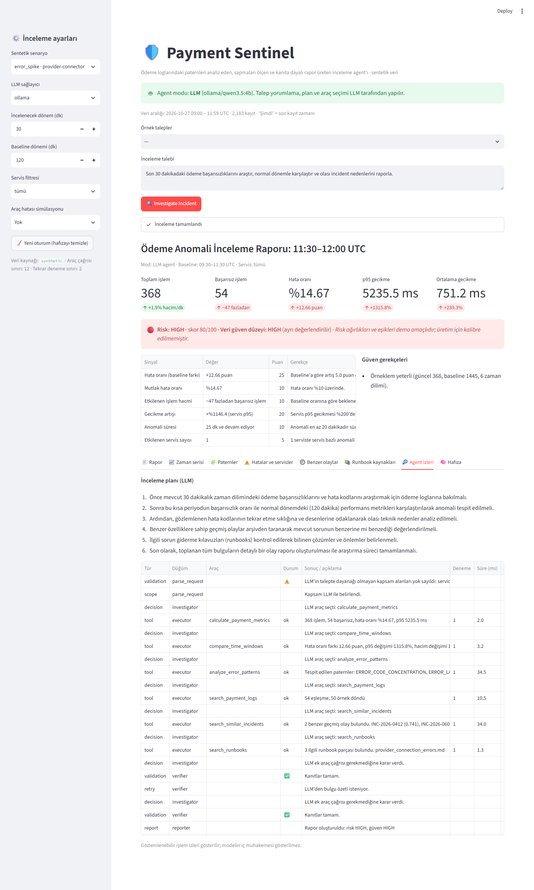 **LLM modu: plan, araç seçimleri, verifier** | 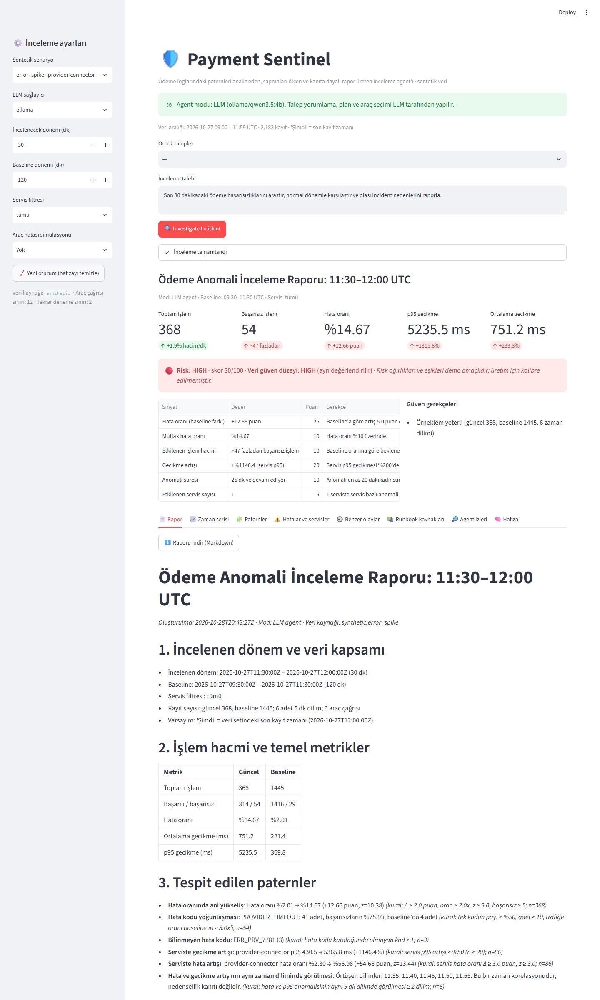 **Kanıta dayalı rapor** |
| 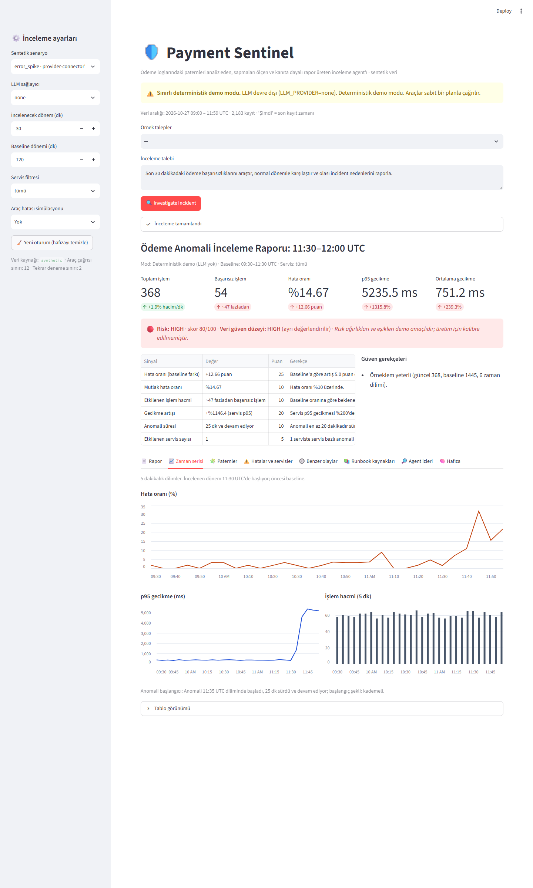 **Hata oranı / p95 / hacim** | 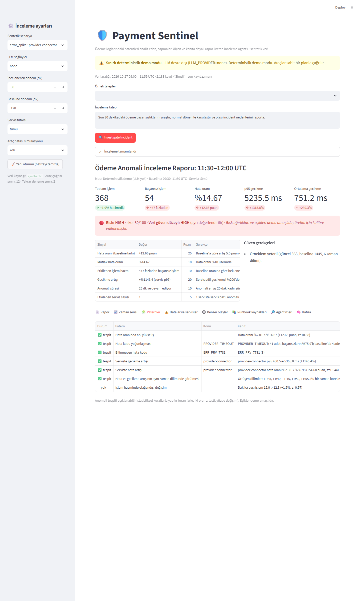 **Açıklanabilir patern kuralları** |
| 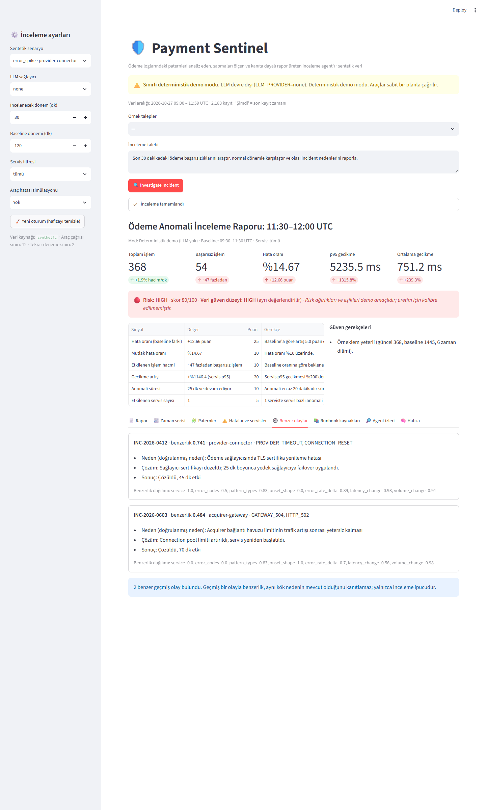 **Geçmiş incident eşleşmesi** | 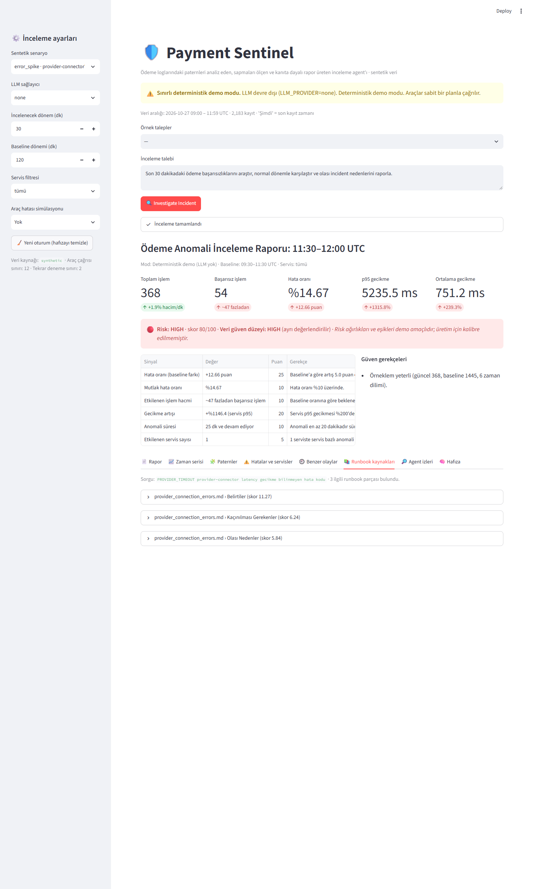 **Kaynaklı runbook araması ve injection ayıklama** |
| 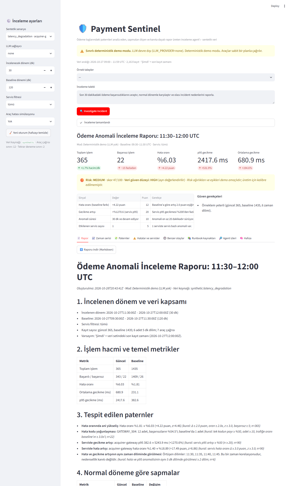 **Gecikme senaryosu** | 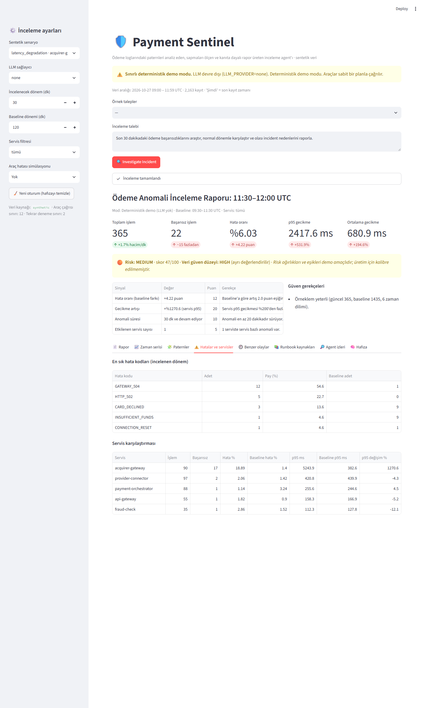 **Servis karşılaştırması** |
| 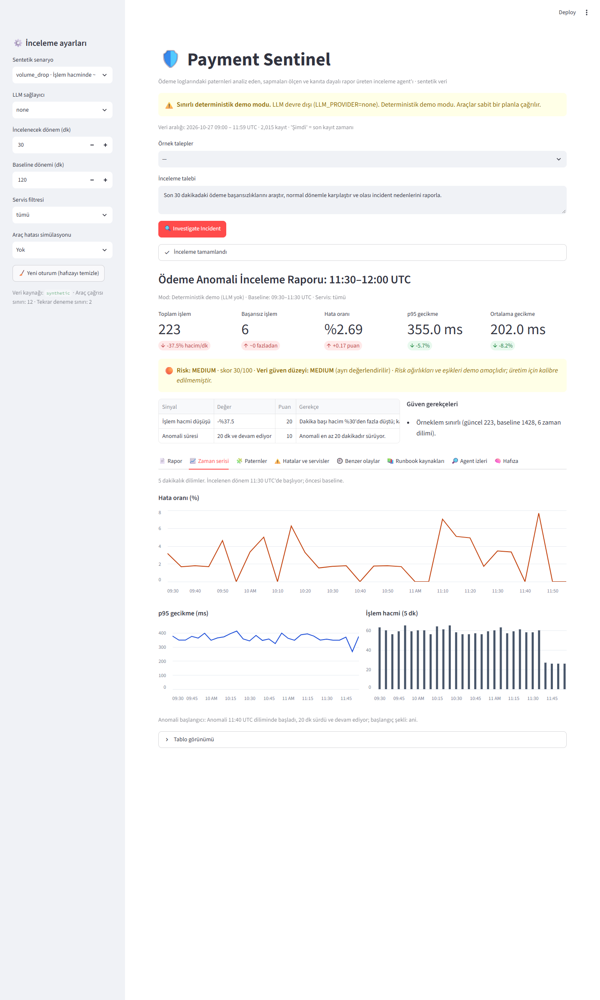 **Hacim düşüşü** | 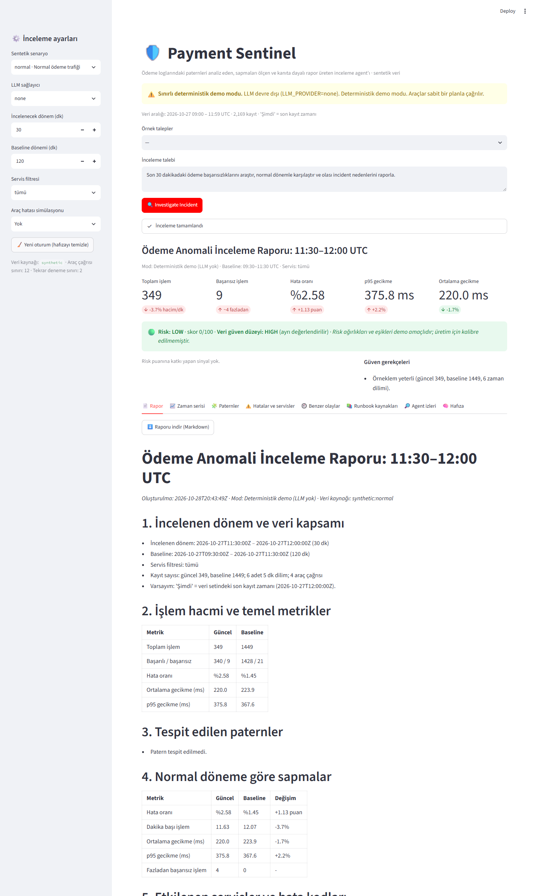 **Normal trafik: yanlış alarm yok** |
| 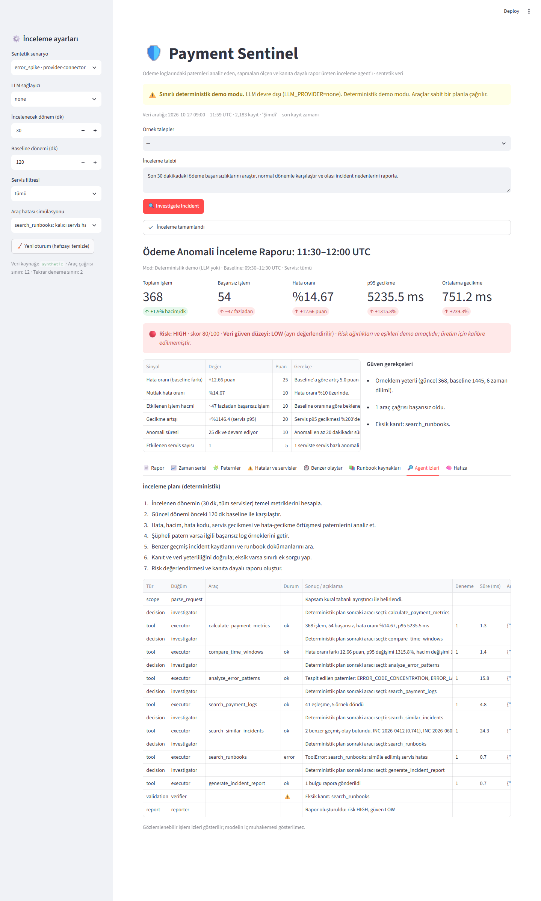 **Araç hatası: risk HIGH, güven LOW** | 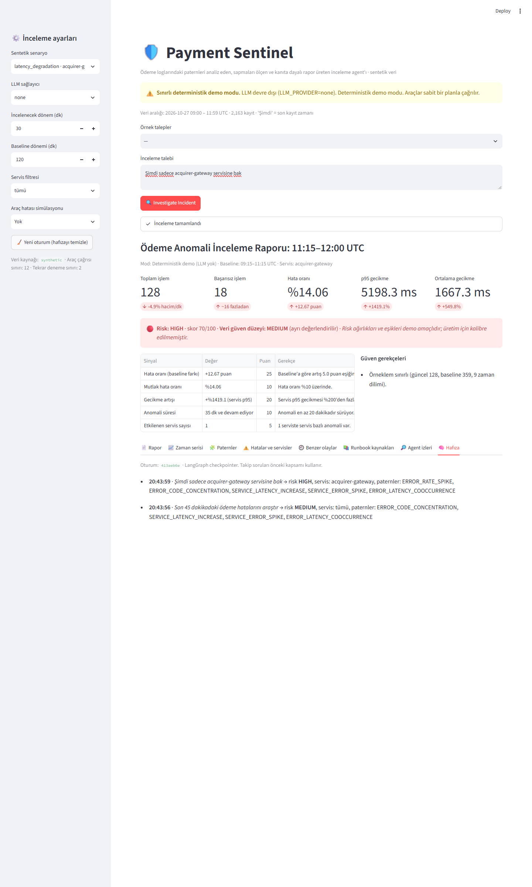 **Takip sorusu ve hafıza** |

## 18. Proje yapısı

```
payment-sentinel/
├── app.py                    # Streamlit arayüzü
├── requirements.txt          # sabitlenmiş bağımlılıklar
├── requirements-es.txt       # opsiyonel Elasticsearch istemcisi
├── requirements-dev.txt      # ekran görüntüsü betiği (Playwright)
├── .env.example
├── src/
│   ├── config.py             # ayarlar, limitler (.env)
│   ├── data_generator.py     # seed=42 sentetik senaryolar
│   ├── datasource/           # DataSource arayüzü, synthetic ve Elasticsearch adaptörleri
│   ├── schemas.py            # Pydantic araç ve rapor şemaları
│   ├── metrics.py            # deterministik metrikler, z-testi
│   ├── patterns.py           # açıklanabilir patern/anomali kuralları
│   ├── incident_matcher.py   # geçmiş olay benzerliği
│   ├── risk_engine.py        # risk skoru + ayrı güven düzeyi
│   ├── retriever.py          # BM25 runbook araması, injection ayıklama
│   ├── tools.py              # agent araçları, izin listesi
│   ├── llm.py                # Ollama/Gemini seçimi, erişilebilirlik kontrolü
│   ├── agent.py              # LangGraph orkestrasyonu
│   ├── validation.py         # girdi, şema ve rapor doğrulamaları
│   └── report.py             # rapor oluşturma ve Markdown
├── data/
│   ├── scenarios/*.jsonl     # 4 senaryo
│   ├── sample_logs.jsonl     # varsayılan örnek (error_spike)
│   ├── incidents.json        # sentetik geçmiş olaylar
│   └── runbooks/*.md
├── tests/                    # 65 test
├── scripts/                  # benchmark.py, screenshots.py
├── benchmarks/results.md
└── screenshots/
```
