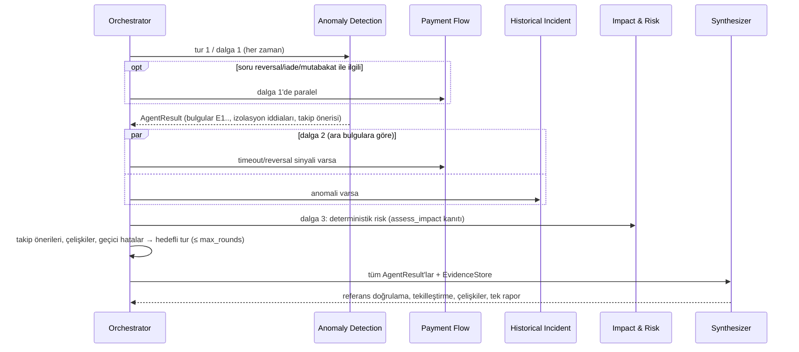

# Payment Sentinel mimarisi

Bu doküman modül sınırlarını, veri akışını ve tasarım kararlarını özetler. Kullanım ve sonuçlar için [README](../README.md).

## Katmanlar ve bağımlılık yönü

```
app.py (Streamlit, iş kuralı yok; mimari seçimi)
  ├─ multiagent/orchestrator.py ── agents.py (4 uzman) ── synthesizer.py
  │     └─ runtime.py (EvidenceStore E1..En, ToolRunner: izin listesi, bütçe, timeout, retry)
  └─ agent.py (LangGraph düğümleri, tek agent) ── policy.py (sonraki adım)
       ├─ tools.py (12 salt okunur araç, Pydantic şemaları: schemas.py)
       │    ├─ analytics/ (dedektörler, kanıt kalitesi, eşikler)   ← metrics.py
       │    ├─ repositories/ (PaymentEvent / HistoricalIncident / Runbook)
       │    ├─ incident_matcher.py, retriever.py
       │    └─ redaction.py
       ├─ risk_engine.py (yalnızca araç çıktılarını okur)
       └─ report.py (risk + gerçek/hipotez + tutarlılık kontrolü)
```

- `analytics/` saf fonksiyonlardan oluşur: girdi depo agregasyonları, çıktı tespit sözlükleridir. Depoya veya LLM'e erişmez.
- `risk_engine.py` ve `report.py` yalnızca kaydedilmiş araç sonuçlarını (`results` / EvidenceStore) okur. LLM metnini sayı kaynağı olarak kullanmaz.
- LLM'e özgü kod `llm.py` (sağlayıcı seçimi), `agent.py` ve `orchestrator.py` içindeki birkaç çağrıyla sınırlıdır.
- İki mimari kapsam kurallarını (`agent.resolve_scope`), araçları, risk motorunu ve rapor üreticisini paylaşır.

## Çoklu agent akışı



| Bileşen | Sorumluluk | Test edilen davranış |
|---|---|---|
| `contracts.py` | `InvestigationContext`, `AgentTask`, `AgentResult` (extra=forbid), `Finding` (en az bir kanıt ref), `Assertion`, `FollowUp`, `ExecutionBudget`, `Conflict` | Geçersiz çıktı → agent `failed` |
| `runtime.py` | Araç izin listesi, toplam araç bütçesi, araç başına timeout (`asyncio.wait_for` + thread), geçici hatada tekrar, çıktı şeması; her çağrı `E<n>` olarak kaydedilir | İzin dışı araç engellenir; bütçe aşılmaz |
| `agents.py` | Uzmanlar deterministik kurallarla araç seçer; bulgu, hipotez, izolasyon iddiası ve takip önerisi döner | Senaryoya göre farklı araç yolları |
| `orchestrator.py` | Dalga planı, paralel `asyncio.gather` (semaphore ile `max_parallel`), agent zaman aşımı, atlanan agent gerekçeleri, takip turları, çelişki çözüm durumu | Paralellik (zaman damgası örtüşmesi), takip turu, zaman aşımı/kısmi hata |
| `synthesizer.py` | Referans doğrulama, kesin neden filtresi, tekilleştirme, çelişki tespiti (izolasyon, tespit, kanıt kalitesi, geçmiş olay kapsamı), risk agent'ı ↔ rapor tutarlılığı | Desteksiz/nedensel iddiaların reddi; agent'ların aynı iddiayı tekrarlaması kanıt sayılmaz |

**Kanıt kuralı:** Bir bulgu yalnızca EvidenceStore'daki başarılı bir araç sonucuna (veya `assess_impact` hesabına) referans verirse rapora girer. Agent'lar birbirinin serbest metnini okumaz; paylaşılan kanıtı okur (ör. ödeme akışı agent'ı kapsam kontrolünü depodan alır, geçmiş olay agent'ı runbook sorgusunu depodaki deterministik tespitlerden kurar).

**Takip turu tetikleyicileri:**
1. Uzman önerisi. Örnek: ödeme akışı "teknik reversal'lar M-007'de; bu üye işyerinde hata/gecikme var mı?" der ve anomali agent'ı M-007 kapsamında yeniden çalışır.
2. İzolasyon çelişkisi. Hedefli bir `breakdown_by_dimension` doğrulaması yapılır; sonuç kaydedilir ve çelişki çözülmüş sayılır.
3. Geçici hata veya zaman aşımı. Bir kez yeniden denenir.

Aynı görev (agent + odak + soru) tekrar çalıştırılmaz.

## Bir incelemenin akışı

1. **parse_request:** Kural tabanlı ayrıştırıcı (ve varsa LLM) talepten zaman aralığı ("son 1 saat", "bu sabah", "10:30-11:45"), banka, üye işyeri, kanal, servis ve takip sorusu bilgisini çıkarır. LLM'in talepte dayanağı olmayan alanları atılır. "Şimdi" = verideki son kayıt.
   - Baseline önceki penceredir. Pencerenin başında veri boşluğu varsa daraltılır.
   - Yetersizse veya "bu sabah" istenmişse baseline dünün aynı penceresi olur.
2. **planner:** Kısa plan (LLM veya deterministik). Plan bilgi amaçlıdır; araç sırasını belirlemez.
3. **investigator:** `policy.next_action(scope, results)` ara sonuçlara bakarak bir sonraki aracı ve gerekçesini üretir.
   - Deterministik modda bu eylem doğrudan çalıştırılır.
   - LLM modunda LLM aracı seçer; politika önerisi ipucu mesajı olarak verilir.
4. **executor:** İzin listesi, Pydantic argüman doğrulaması, thread havuzunda araç timeout'u, geçici hatada 1 tekrar, çıktı şeması doğrulaması. Her çağrı izlere `step, tool, scope, decision_reason, summary, attempts, duration_ms` olarak yazılır.
5. **verifier:** `policy.required_evidence` ile eksik kanıtı bulur. En fazla 2 kez ek sorgu ister: LLM'e hatırlatır veya deterministik tamamlar. Kalıcı hata veren araçlar tekrar denenmez ve sınırlama olarak raporlanır.
6. **summarizer:** LLM varsa yalnızca araç gerçeklerinden 3-6 bulgu ister. Bulgular rapordan önce sayı ve nedensellik iddiası açısından süzülür.
7. **reporter:** Deterministik risk, 14 bölümlü rapor, tutarlılık kontrolü ve hafızaya (checkpointer) özet.

## Politika kuralları (özet)

| Koşul | Eylem |
|---|---|
| Her inceleme | `check_data_coverage`, `compare_with_baseline` |
| Kapsam `insufficient` | Erken bitir (`submit_findings`), rapor `insufficient_evidence` |
| Teknik hata veya timeout artışı | `breakdown_by_dimension(bank_id)`; izole değilse `breakdown_by_dimension(service_name)`; ardından etkilenen kapsamda `analyze_response_codes` |
| `breakdown_by_dimension` kalıcı hata | Alternatif: `analyze_response_codes(dimension=…)` |
| Red artışı (teknik hata yok) | `analyze_response_codes(dimension=bank_id)` |
| Timeout veya gecikme | Etkilenen kapsamda `analyze_latency_timeouts` |
| İzole servis (veya talepte deployment) | `compare_service_versions` |
| Reversal sinyali, timeout veya talepte reversal | `analyze_reversals`; teknik reversal varsa `breakdown_by_dimension(merchant_id, reversal_ratio)` ve segment içinde tekrar |
| Herhangi bir tespit | `search_transactions` → `search_similar_incidents` → `search_runbooks` |
| Son | `submit_findings` |

## Tespit sözleşmesi

Her dedektör aynı sözlüğü döner (`schemas.Detection`):

```
detector, detected, subject, metric, unit, observed, baseline, abs_deviation, rel_deviation_pct,
window, baseline_window, scope, sample_size{current, baseline}, evidence_quality, insufficient_data,
statistic, method, limitations[], claim_type (observation|correlation|hypothesis), evidence, extra
```

`evidence_quality == "insufficient"` ise `detected` daima `False` olur.

## Veri erişimi sözleşmesi

`PaymentEventRepository` public metotları sınırları uygular, ardından adaptörün `_impl` metodunu çağırır:

| Metot | Dönüş |
|---|---|
| `summary(f)` | total (birincil), approved, declined, technical, timeouts, errors, reversals, refunds, events, avg/p50/p95/p99 (timeout hariç) |
| `histogram(f, dk)` | Dilim başına aynı istatistik |
| `group_by(f, alan)` | Segment başına aynı istatistik (≤ 20) |
| `top_terms(f, alan)` | Birincil işlem sayıları |
| `sample(f, limit, cursor)` | Maskelenmiş kayıtlar, toplam, sonraki imleç |
| `reversal_linkage(f, lookback, auto_s)` | Reversal sınıfları, reversal'sız timeout, teknik reversal'ların üye işyeri/banka dağılımı, `truncated` |
| `field_quality(f)` | Anahtar alan boş değer oranları |
| `bounds(f)` | İlk/son olay zamanı (sürümün ilk görüldüğü an) |

`HistoricalIncidentRepository.all()` ve `RunbookRepository.documents()` dosya tabanlıdır. Arayüzler, wiki veya incident yönetim sistemi gibi başka kaynaklara bağlanabilecek şekilde ayrılmıştır.

## Tasarım kararları

- **Neden kural tabanlı istatistik, ML değil?** Her tespitin eşiği, testi ve örneklemi raporda açıklanabilir ve test edilebilir olmalı. Etiketli gerçek veri olmadan eğitilmiş bir model doğrulanamaz.
- **Neden Bonferroni?** Banka, üye işyeri ve sürüm kırılımında çok sayıda segment test edilir. Düzeltmesiz z eşiği normal dalgalanmada yanlış "izole" sonuçları üretirdi.
- **Neden D-1 aynı pencere?** Sabah rampası nedeniyle önceki pencereyle hacim karşılaştırması sistematik olarak "artış" gösterir.
- **Neden politika + LLM?** Küçük yerel modeller araç seçiminde tutarsız olabilir. Politika hem LLM yokken çalışan bir yedek, hem LLM için ipucu, hem de verifier için zorunlu kanıt kaynağıdır. Böylece aynı kanıt kuralları iki modda da geçerlidir.
- **Neden çoklu agent?** Anomali istatistiği, ödeme akışı ilişkileri, kurum bilgisi ve risk hesabı farklı araç kümeleri ve farklı hata modları gerektiriyor. Ayrı sorumluluklar şunları sağlıyor:
  - Her agent'ın izin listesi dar tutulabiliyor.
  - Bağımsız işler paralel çalışıyor.
  - Bir uzmanın hatası diğerlerinin bulgularını geçersiz kılmıyor.
  - Ara bulgulara göre hedefli takip yapılabiliyor.

  Bunun bedeli ek koordinasyon kodudur. Bu kod küçük bir `asyncio` katmanında tutuldu ve tamamı test ediliyor.
- **Neden uzmanlar deterministik?** Her uzmanın kararı için LLM çağırmak gecikme ve tutarsızlık ekler; sayıların doğruluğu zaten araçlardan geliyor. LLM yalnızca anlamın gerektiği yerde (ilk agent seçimi, bulgu özeti) kullanılır ve çıktısı doğrulanır.
- **Neden BM25?** Runbook ve incident metinlerinde yanıt kodu, banka ve servis adları gibi tam eşleşme önemli terimler var. BM25 deterministiktir ve model indirmeyi gerektirmez.
